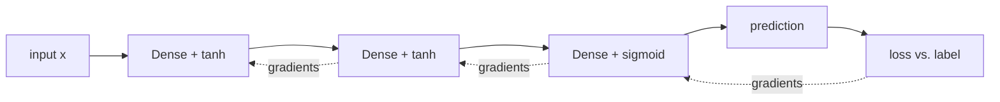

# neural-net-from-scratch-ts

A small neural network written from scratch in TypeScript. No TensorFlow, no NumPy, no ML library: just arrays, loops and the chain rule.

I built it to understand what actually happens inside a model before working with LLMs, RAG and agents. Every step of the learning cycle is explicit and commented in the code.

```
data → forward pass → loss → backpropagation → gradient descent → validation → inference
```

## What it does

**XOR** (`npm run xor`): the classic problem a single neuron cannot solve.

```
Before training (random weights):
  0 XOR 1 → 0.569  (expected 1)
  1 XOR 1 → 0.446  (expected 0)

Loss curve: ███▇▅▃▂▂▁▁▁▁▁▁▁▁▁▁▁▁▁▁▁▁▁▁▁▁▁▁▁▁▁▁▁▁▁▁▁▁▁▁▁▁▁▁▁▁▁▁▁▁▁▁▁▁▁▁▁▁▁

After training:
  0 XOR 1 → 0.997  (expected 1)
  1 XOR 1 → 0.004  (expected 0)
```

**Circle classification** (`npm run circle`): 600 random points, 5% of them with wrong labels on purpose. The network has to discover a round boundary on its own, and is measured on points it never saw.

```
Training accuracy:   91.3%
Validation accuracy: 92.5%

Decision map ('#' = inside the circle):
···············################·················
·············######################·············
··········############################··········
·········#############################··········
···········#########################············
··············##################················
················#############···················
```

## How it is built

| File | Responsibility |
| --- | --- |
| [`src/network.ts`](src/network.ts) | Layers, forward pass, backpropagation and mini-batch gradient descent |
| [`src/activations.ts`](src/activations.ts) | sigmoid, tanh, ReLU and linear, with their derivatives |
| [`src/losses.ts`](src/losses.ts) | Mean squared error and binary cross-entropy |
| [`src/data.ts`](src/data.ts) | Datasets, train/validation split and accuracy |
| [`src/random.ts`](src/random.ts) | Seeded random generator, so every run is reproducible |
| [`src/plot.ts`](src/plot.ts) | Terminal loss curve and decision map |



## Design decisions

- **Plain arrays instead of a matrix library.** Slower, but every multiplication is visible. The goal is understanding, not speed.
- **Xavier/Glorot initialization.** Weights start random but scaled by layer size. With all-zero weights every neuron would learn the same thing; with large weights the tanh/sigmoid saturate and learning stalls.
- **Binary cross-entropy for classification.** It punishes confident wrong answers much harder than MSE, which gives a stronger learning signal when paired with a sigmoid output.
- **Seeded randomness.** Same seed, same result. Without it you cannot tell whether a change helped or you just got lucky.
- **Gradient check in the tests.** Backpropagation is compared against a brute-force numerical derivative for every weight. This is how you prove the calculus is right instead of hoping it is.

## Running

Requires Node.js 20+.

```bash
npm install
npm run xor        # train on XOR
npm run circle     # full cycle: data → training → validation → inference
npm test           # gradient check + learning tests
```

## What I learned

- Training is just an optimization loop: measure the error, compute how each weight contributed to it, move the weights a little in the opposite direction.
- Validation loss is the number that matters. Training accuracy alone says nothing about how the model behaves on new data.
- With noisy labels, 100% accuracy is impossible and would actually mean memorization. Here the ceiling is about 95%.
- The same ideas (weights, loss, gradients, embeddings as learned vectors) scale up to the transformers behind LLMs.

## Next steps

- [ ] Browser version with TensorFlow.js: train live and watch the decision map change
- [ ] Softmax + categorical cross-entropy for more than two classes
- [ ] Momentum / Adam optimizer and a comparison of convergence speed

---

Project 1 of my Applied AI Engineering learning path (front-end focus). Concepts explained in Portuguese in [`docs/CONCEITOS.md`](docs/CONCEITOS.md).
